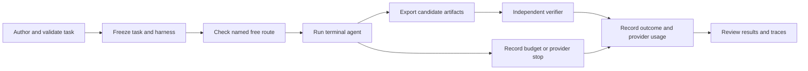

# Case study: a $0 terminal-agent evaluation workflow

Four free OpenRouter models attempted the same three scientific software tasks
twice each. The completed calibration contains **24 trials, 14 verified passes,
10 token/output-limit stops and $0 in reported model charges**. It demonstrates
the evaluation workflow and produces inspectable evidence. It does not measure
broad model quality or a separate holdout.

Start with the [visual report](../reports/free-model-case-study/index.html),
[machine-readable summary](../reports/free-model-case-study/summary.json) or
[model results CSV](../reports/free-model-case-study/model-results.csv).

## What the models had to do

| Task family | Engineering work | What determines correctness |
| --- | --- | --- |
| Scientific ETL | Repair a measurement pipeline with quality flags, unit conversions and duplicate records | Exact filtering, conversion, ordering and output behavior |
| Geospatial raster | Combine GeoTIFFs with different grids, coordinate systems and NoData | Correct transforms, alignment, masking and numerical output |
| Repository debugging | Repair an interval-merging Python API and CLI | Touching boundaries, empty/reversed intervals, idempotence and API behavior |

All fixtures are synthetic. Each task had to pass fresh Docker controls before
the corresponding model attempts: two oracle runs, an alternative valid solution,
and rejection of a no-op, a known wrong solution and a negative mutation. The
agent received the task contract and public workspace. The reference solution
and grader stayed in a separate trusted environment.



The original three models ran on November 2, 2026. Flint was added on November 5
using the exact same task versions, prompt/parser hashes and harness limits.
The tasks were not regenerated. Both campaigns used Harbor 0.13.2, two repeats,
temperature zero, low reasoning, 8,192 output tokens per call and the same
cumulative token/time limits. The transport was extended to support Flint's
documented endpoint variant without changing the task or agent protocol.

## Actual model results

| Model | Passes / planned trials | Other outcomes | Model charges |
| --- | ---: | --- | ---: |
| Cohere North Mini Code | 0/6 | Six token/output-budget stops | $0 |
| NVIDIA Nemotron 3.5 Super VL | 6/6 | None | $0 |
| NVIDIA Nemotron 3 Ultra | 6/6 | None | $0 |
| Recursive Flint | 2/6 | Three per-response output stops; one cumulative-token stop | $0 |

The matrices used **138 provider requests**. Four separate availability probes
also reported $0. Two earlier protocol-development requests are outside those
counts and remain in their original records. A trial contains several model
requests; 138 requests are not 138 independent task attempts.

`AGENT_TIMEOUT` groups the token/output-limit stops in these records. A stopped
trial counts as an unsuccessful completion. It is not a verifier rejection when
the verifier never ran. Missing usage cannot be interpreted as zero cost.

The published receipts are [the original calibration](evidence/hf02-free-openrouter-2026-11-02.json)
and [the Flint supplement](evidence/hf02-flint-openrouter-2026-11-05.json).
They bind results to exact model/profile identities and source/configuration
hashes. The visual report is rebuilt from these published aggregates, rather
than by exporting the private calibration registry.

## A runnable example: the total looks right, but the output is wrong

The public `repository-debug-100-v1` fixture has a small, concrete bug: its
interval merger combines overlapping ranges but leaves touching ranges separate.
The contract requires both to merge.

For the bundled synthetic input, the starter produces:

```json
{"intervals":[[-11,-6],[-4,0],[0,3],[5,9],[9,14]],"covered":21}
```

The repaired program produces:

```json
{"intervals":[[-11,-6],[-4,3],[5,14]],"covered":21}
```

Both report `covered: 21`. Checking only that total would accept the wrong
canonical interval union. The essential repair is:

```diff
-        if merged and start < merged[-1][1]:
+        if merged and start <= merged[-1][1]:
```

The example builder actually executes the starter, checks its rejection, applies
the existing authored reference repair, then checks acceptance and all six local
controls. Its input, before/after JSON, repaired source, patch and verification
record appear under [report samples](../reports/free-model-case-study/samples/).
This replay uses trusted public author code and makes **zero new model calls**.
The sample is a reference demonstration, not a newly generated Flint answer or
a Docker isolation test.

This archived public fixture predates the current Docker package contract and
lacks its separate verifier Dockerfile. The replay runs its six local behavioral
controls explicitly. It does not make that old fixture eligible for new model
evaluation. The actual model results above came from the separately validated
calibration task versions.

Rebuild it from the repository root into a fresh directory:

```powershell
.\.venv\Scripts\python.exe scripts/build_free_model_case_study.py --output-dir artifacts/case-study-replay
```

Open `artifacts/case-study-replay/index.html`. The builder refuses an existing
output directory and verifies the original task hash before and after execution.
It does not need an API key, a browser, Docker or provider access.

## One actual Flint success and one actual stop

In a successful repository-debug trial, Flint inspected the source and input,
changed the touching-boundary condition to `<=`, ran the CLI, checked empty,
reversed and duplicate intervals, and checked repeated output generation. The
independent verifier then awarded reward 1.0. That trial used five verified
provider requests at $0. The model also reformatted the source and introduced
a `main()` function; the behavioral boundary change is the relevant repair.

A contrasting geospatial trial reached a per-response output limit. Its receipt
records `OutputLengthExceededError` and no verifier verdict. That establishes a
failure to finish under this protocol, not that its exported raster was graded
incorrectly. A hypothesis about geospatial reasoning would need more evidence.

The local worked example includes the actual input, candidate diff, output,
command timeline, verifier receipt and contrasting stop. It stays under ignored
`artifacts/case-study-2026-11-05/actual-flint/`, alongside the private model
reports. It is not included in the public report because calibration task
content and full model traces remain private. Reading the example does not
execute candidate code or start another model run.

## Interpretation and next steps

Super VL and Ultra completed all six calibration attempts. Flint completed both
repository-debug attempts, while its ETL and geospatial attempts hit token/output
limits. This supports using Super VL as the initial default in this pilot and
retaining Flint as a coding baseline. Six attempts per model over three templates
cannot establish general superiority, robust uncertainty intervals or behavior
on new scientific problems. The two execution dates also allow provider drift.

The next scientific step is a preregistered, independently developed holdout and
a matched parent/child mutation experiment. Those measurements have not been
completed. The original expanded 144-trial showcase remains a proposal. New
inference requires fresh model/account evidence; paid work remains outside the
authorized $0 scope. Rebuilding this report makes no inference requests.
