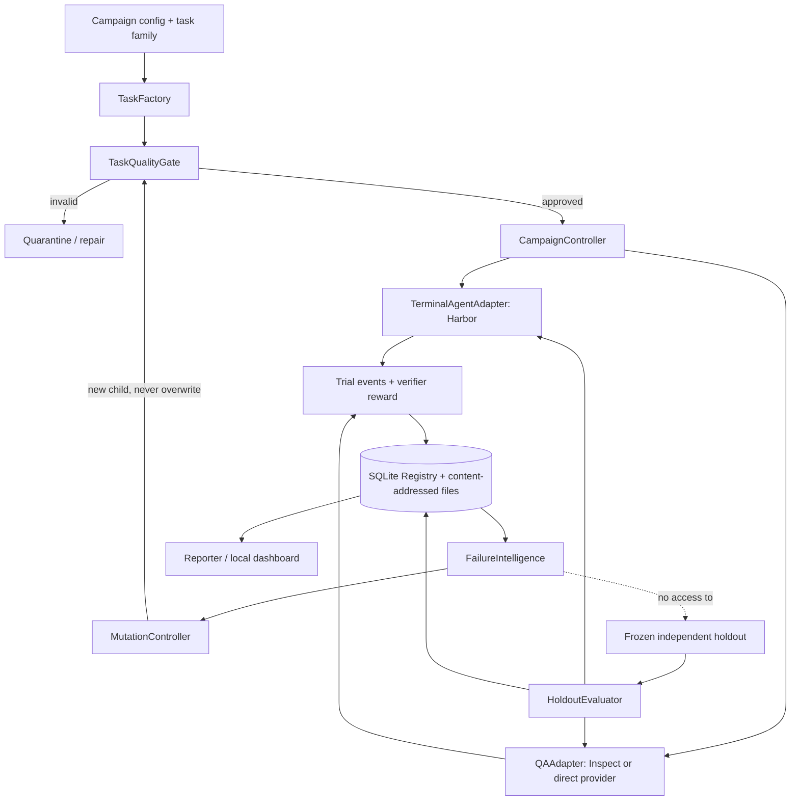
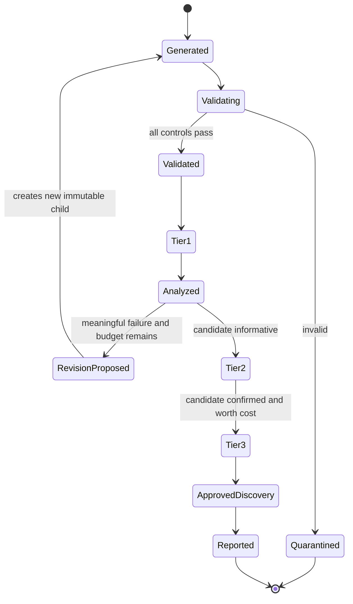

# System Design: HarborForge Eval Lab

## Boundary diagram



## Suggested repo structure

```text
Red_Team_Project/
  pyproject.toml
  README.md
  src/harborforge/
    cli.py                    # Typer CLI and exit codes
    config.py                 # Pydantic campaign/model configuration
    task_families/
      registry.py
      scientific_etl.py
      geospatial_raster.py
      repository_debug.py
      legacy_comp3.py
    authoring/
      generator.py
      mutations.py
      provenance.py
      spec_to_harbor.py
    validation/
      quality_gates.py
      oracle.py
      negative_controls.py
      leakage.py
    adapters/
      base.py
      harbor_adapter.py
      qa_adapter.py
      model_registry.py
    execution/
      campaign.py
      budget.py
      retry.py
      trial_events.py
    analysis/
      failure_classifier.py
      trace_scanner.py
      adjudication.py
      statistics.py
      reporting.py
    storage/
      registry.py
      migrations/
      artifact_store.py
  tasks/public_examples/
  evals/calibration/
  evals/holdout_private/     # NEVER commit actual holdout to public repo
  configs/
    model_profiles.yaml
    campaigns/
  tests/
    unit/
    integration/
    contract/
    e2e/
  docs/
    METHODS.md
    TASK_AUTHORING.md
    REPRODUCE.md
  artifacts/                  # gitignored, hashed, with retention policy
```

Preserve existing legacy files under `legacy/` until their equivalents have contract tests and the CLI migration is complete. Avoid maintaining two uncontrolled mutable sources of truth.

## Typed interfaces

```python
from dataclasses import dataclass
from typing import Protocol, Literal

Outcome = Literal[
    "PASS", "MODEL_FAIL", "AGENT_TIMEOUT", "PROVIDER_ERROR",
    "INFRA_ERROR", "INVALID_TASK", "UNSCORABLE"
]

@dataclass(frozen=True)
class TrialRequest:
    task_version_id: str
    task_artifact_sha256: str
    model_profile_id: str
    harness_profile_id: str
    repeat_index: int
    campaign_id: str
    seed: int | None

@dataclass(frozen=True)
class TrialResult:
    trial_id: str
    outcome: Outcome
    reward: float | None
    verifier_status: str
    trajectory_sha256: str | None
    cost_usd: float | None
    wall_time_s: float
    error_code: str | None

class AgentAdapter(Protocol):
    def run_trial(self, request: TrialRequest) -> TrialResult: ...

class TaskQualityGate(Protocol):
    def validate(self, task_version_id: str) -> list[dict]: ...

class FailureAnalyzer(Protocol):
    def analyze(self, trial_id: str) -> list[dict]: ...
```

The interface is illustrative. Real implementation should be fully typed, versioned and tested. Do not log provider credentials or raw private grader content in agent-visible traces.

## Task lifecycle state machine



The frozen holdout is **not** reachable through this mutation state machine. Its evaluator loads a separate sealed task manifest under a review-controlled command.

## Model registry and harness reproducibility

`model_profile` identifies provider, model API name and version, optional snapshot, provider family, capabilities (tools, images, structured output), sampling/reasoning settings, token limit, budget and price source timestamp. `harness_profile` holds agent implementation and version, system prompt checksum, tool schema checksum, Docker image digest, limits, verifier version and network mode. Neither should be silently modified during a campaign.

**Do not treat API model aliases as immutable snapshots.** Record requested identifier and actual provider-returned model metadata where available, and make alias drift visible.

## Task package contract

Each task has two distinct layers:

- **Public/agent-facing:** instruction, environment, initial workspace, allowed input files, explicit output-artifact contract.
- **Private authoring/scoring:** oracle solution, hidden verifier, negative controls, requirements coverage map, expected error behavior, adversarial mutation metadata.

For an executable agent benchmark, `task.toml`, `instruction.md`, `environment/Dockerfile`, `solution/solve.sh` and `tests/test.sh` follow the **installed, pinned Harbor task schema**, not an ad-hoc approximation. Harbor copies the Oracle solution only for an Oracle run. The verifier runs after the agent in its own environment or dedicated protected phase. The agent's environment must never bake the solution or hidden tests into image layers.

The solution **output artifact** might be `/app/output/result.json`. The **verifier reward** belongs in `/logs/verifier/reward.json` (or `.txt`), where the grading harness writes it after verifying the agent artifact. These are not interchangeable.

## Control and isolation details

- Docker container runtime pinning, non-root user, read-only mounts for fixtures when possible, CPU/memory limits, timeouts, network disabled unless a task explicitly requires it.
- Docker build contexts exclude oracle/tests for the **agent image**. Treat generated tasks and agent commands as untrusted code.
- Provider API credentials remain outside containers and their logs. Explicitly restrict environment variables, host mounts and Docker socket access.
- Separate verifier receives only declared agent-produced artifacts and protected tests, not the original agent environment by default.
- Task tests should run after agent completion. Do not provide hidden expected answers in the prompt, filenames, Docker layers, process args or accessible logs.
- A failed verifier or infrastructure failure is not scored as an agent correctness failure.

## Event and artifact persistence

Use a JSONL event sequence per `trial_id` with fields `sequence`, `monotonic_ms`, `event_type`, `payload_redacted`, `blob_ref` and `timestamp_utc`. Events include `agent_message`, `tool_call`, `tool_result`, `file_diff`, `verifier_result`, `provider_error`, `resource_sample`, and `final_outcome`. Large outputs and logs are stored in content-addressed files instead of mutable database cells.

The SQLite registry tracks campaigns, task families/versions, validations, model/harness profiles, trials, failure findings, review labels, and artifacts. Report generation queries only final, valid trials in the prescribed measurement cohort, and includes rejected/errored counts separately.

## CLI experience (proposed)

```powershell
# The commands below are design targets, not implemented in the existing repository.
redforge task generate --family scientific-etl --seed 123 --count 3
redforge task validate --task tasks/generated/etl-001 --controls all
redforge campaign run --config configs/campaigns/scientific-pilot.yaml --tier screen
redforge campaign analyze --campaign scientific-pilot
redforge task revise --task etl-001 --from-evidence trial-abc --max-children 2
redforge campaign confirm --campaign scientific-pilot --tier frontier
redforge eval freeze --suite pilot-holdout --manifest evals/private-manifest.yaml
redforge eval run --suite pilot-holdout --campaign config/final-eval.yaml
redforge report build --campaign scientific-pilot --out reports/pilot
```

## Dashboard MVP

1. **Quality funnel:** generated, valid, rejected (with cause), Tier 1 screened, Tier 2 confirmed, Tier 3 validated, published.
2. **Model comparison:** task × model matrix, attempts and pass rates, confidence intervals, family breakdown, infra error counts.
3. **Trace explorer:** command sequence, file diffs, tests, verifier evidence and replay pointers.
4. **Failure intelligence:** annotated categories, novelty, invalid-task findings, disagreement and reviewer corrections.
5. **Task lineage:** parent/child versions, mutation rationale, gate results, paired change in performance and cost.
6. **Study card:** model IDs, harness profiles, environment, date, suite hash and reproducibility commands.

Static HTML report + CSV/JSON export must precede an interactive UI. The interface must never display fabricated pass rates or infer outcomes from incomplete runs.
